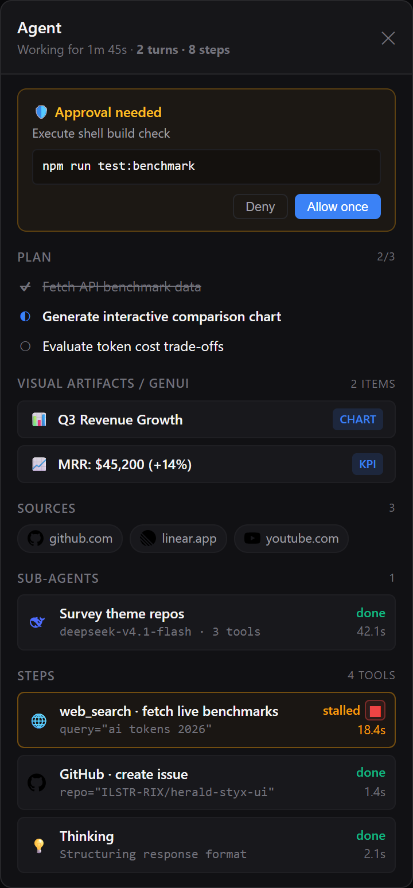
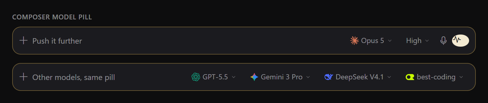
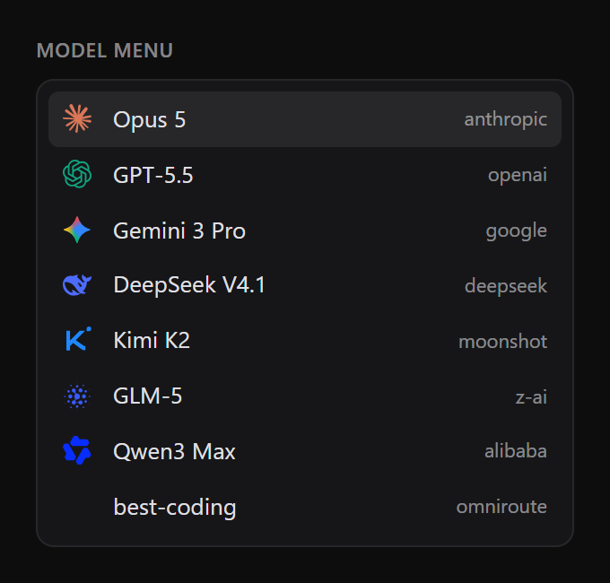
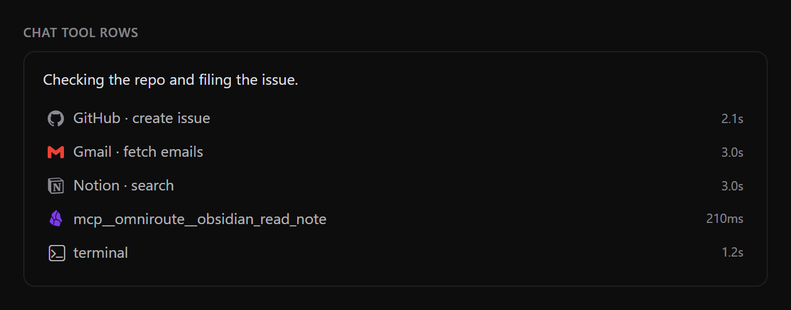
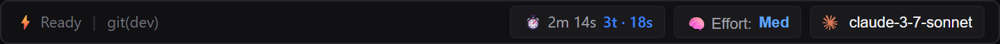
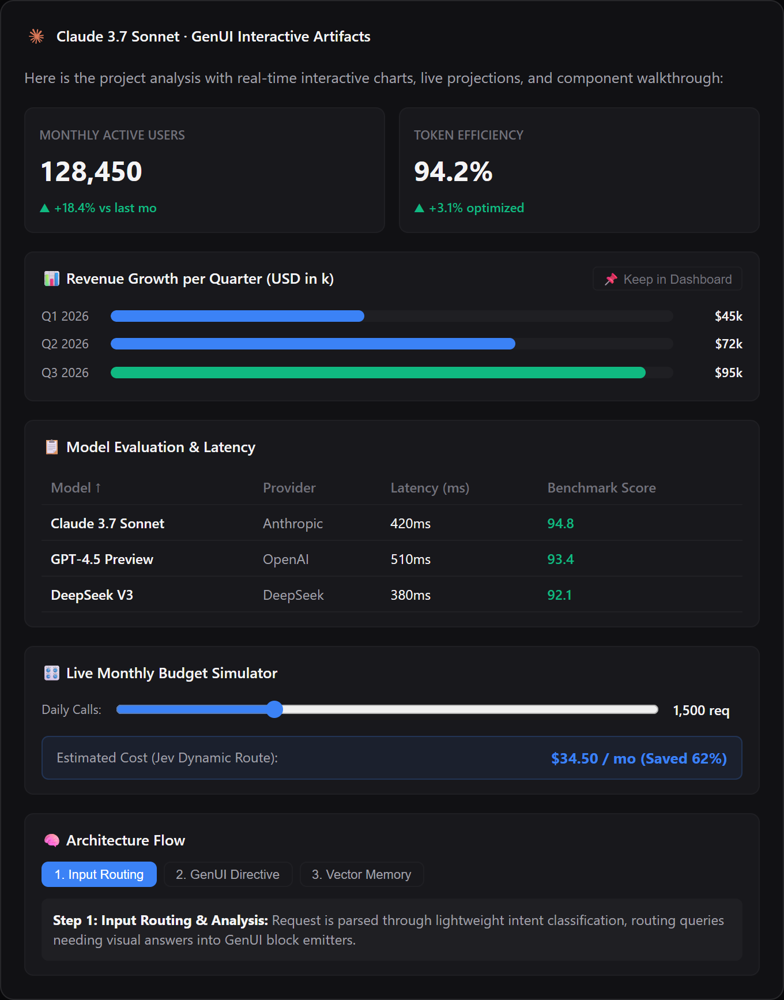
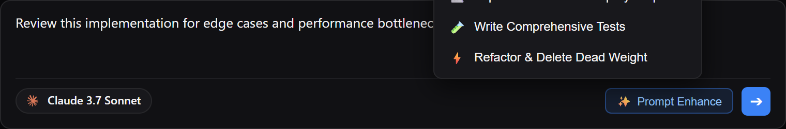
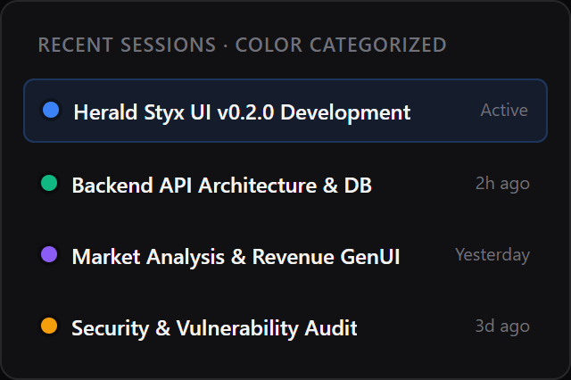
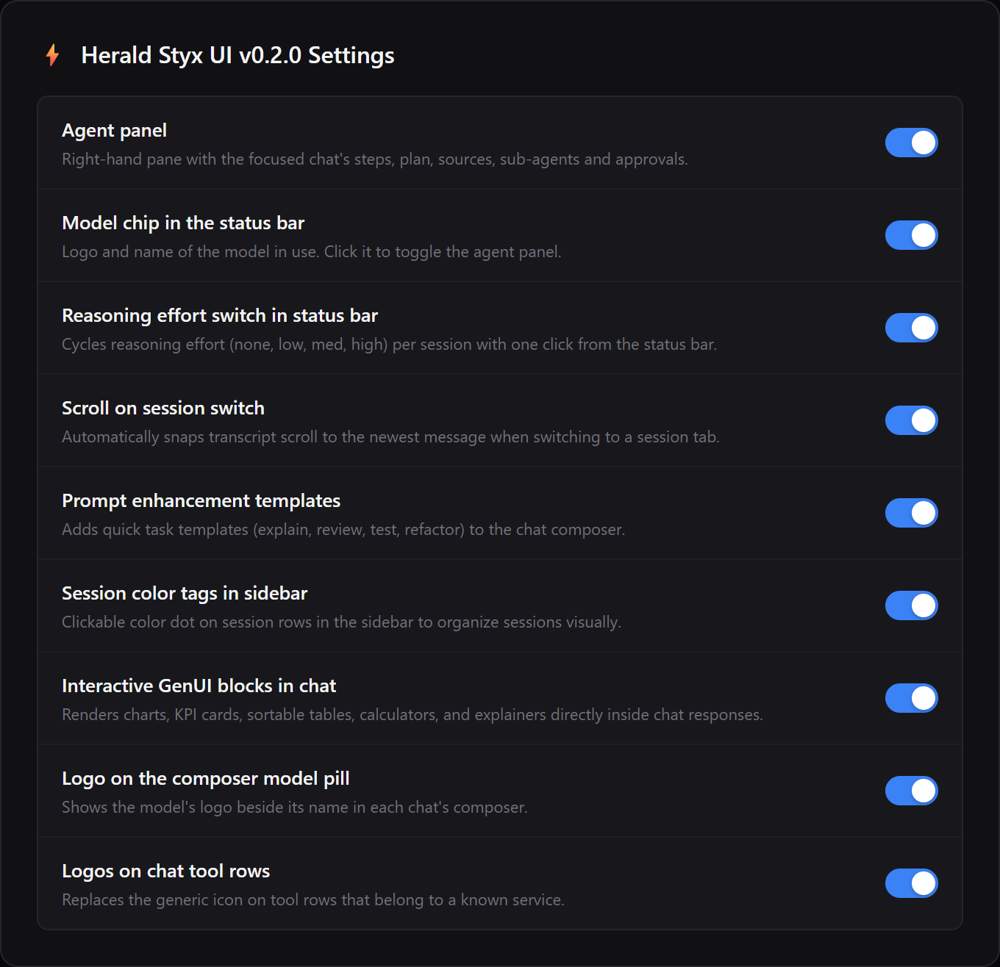

# Herald Styx UI

1. **Logo model dan service**: di model menu, di model pill pada composer tiap chat (di samping nama model), sebagai model chip di status bar, dan di tool row pada chat.
2. **Agent panel & observabilitas kerja**: pane kanan mengikuti chat aktif, menampilkan durasi & iteration meter (`N turns · M steps`), plan (todo), visual artifacts, sources, sub-agent, serta approval.
3. **Intelligent Tool Break & Stalled Indicator**: tombol interupsi darurat langsung pada baris step yang sedang `running` atau macet.
4. **Interactive GenUI**: merender grafik bar SVG responsif, KPI metric cards, sortable tables, live calculators dengan slider dinamis, dan step-by-step explainers langsung di dalam chat.
5. **Kontrol status bar & composer**: tombol ganti *reasoning effort* instan di status bar kanan, serta template *Prompt Enhance* di composer chat.
6. **Kustomisasi sesi & navigasi**: pewarnaan tag sesi di sidebar (`SESSION_ROW_AREAS`) dan *scroll-on-switch* otomatis ke pesan terbaru.

Plugin ini tidak mengubah warna atau layout dasar, jadi skin default, Monograph, atau tema lain tetap konsisten.

## Preview

Semua gambar ada di folder [`preview/`](preview). Gambar dirender dari `dist/plugin.js` yang asli di dalam tiruan UI Hermes (tema gelap default), dengan data contoh.

<p align="center">
  
</p>
| Composer model pill | Model menu |
|---|---|
|  |  |

| Chat tool rows | Status bar controls (Model & Reasoning) |
|---|---|
|  |  |

| Interactive GenUI Blocks in Chat | Composer Prompt Enhance |
|---|---|
|  |  |

| Session Color Tags (Sidebar) | Settings Herald Styx UI v0.2.0 |
|---|---|
|  |  |
## Install

Plugin ini hanya satu file: `dist/plugin.js`. Node tidak diperlukan untuk memasangnya.

| OS | Salin ke |
|---|---|
| Windows | `%LOCALAPPDATA%\hermes\desktop-plugins\herald-styx-ui\plugin.js` |
| macOS / Linux | `~/.hermes/desktop-plugins/herald-styx-ui/plugin.js` |

Nama folder harus `herald-styx-ui`. Desktop plugin berlaku di tingkat aplikasi, jadi satu salinan sudah mencakup semua profile.

PowerShell (Windows):

```powershell
$dst = "$env:LOCALAPPDATA\hermes\desktop-plugins\herald-styx-ui"
New-Item -ItemType Directory -Force $dst | Out-Null
Copy-Item .\dist\plugin.js "$dst\plugin.js" -Force
```

Aplikasi memuat plugin dalam beberapa detik. Jika tidak ada yang muncul, buka ⌘K / Ctrl+K lalu jalankan **Reload desktop plugins**.

## Penggunaan

| Apa | Di mana |
|---|---|
| Membuka atau menutup agent panel | ⌘K / Ctrl+K, lalu **Herald Styx UI: Toggle agent panel**, atau klik model chip di status bar |
| Pengaturan | Settings > Plugins > Herald Styx UI: panel, chip status bar, logo di model pill composer, logo di chat row |
| Mematikan seluruh plugin | Capabilities > Plugins > Herald Styx UI (langsung berlaku, tanpa restart) |

## Uninstall

Hapus folder `herald-styx-ui` dari `desktop-plugins`. Tidak ada file lain yang ditulis: pengaturan disimpan di local storage aplikasi dengan prefix `hermes.plugin.herald-styx-ui.*`.

### Pindah dari Agent Lens

Plugin ini dulu bernama Agent Lens (folder `agent-lens`). Hapus folder `desktop-plugins/agent-lens` supaya plugin tidak termuat dua kali. Pengaturan lama di `hermes.plugin.agent-lens.*` tidak ikut pindah, jadi atur ulang toggle di Settings bila perlu.

## Menambah logo

Panduan lengkap, termasuk cara memilih alias dan checklist pull request, ada di [CONTRIBUTING.md](CONTRIBUTING.md).

1. Tambahkan satu baris ke `logos.config.json`: `[id, [substring yang dicocokkan], "lobe:<name>" | "si:<slug>", "#warna"]`.
   - Ikon `lobe:` berasal dari [@lobehub/icons-static-svg](https://lobehub.com/icons) (model)
   - Ikon `si:` berasal dari [simple-icons](https://simpleicons.org) (service)
2. Jalankan `node scripts/build.mjs` (Node 18+, tanpa npm install). Ikon diunduh sekali ke `.cache/`, dibersihkan dari script dan referensi eksternal, lalu disisipkan langsung ke `dist/plugin.js`.
3. `node scripts/build.mjs --install` juga menyalin hasil build ke `$HERMES_HOME/desktop-plugins/herald-styx-ui/` (di Windows, set `HERMES_HOME` ke `%LOCALAPPDATA%\hermes`).

Pencocokan memakai substring tanpa membedakan huruf besar-kecil, dan baris pertama yang cocok yang dipakai. Model dicocokkan lewat model id lebih dulu, baru lewat provider, jadi `openrouter/anthropic/claude-opus-4.5` menampilkan Claude. Router alias seperti `auto/best-coding` tidak memuat nama vendor. Untuk kasus ini, chip status bar memakai provider dari `session.info` milik chat, model menu memakai provider dari tiap row, dan model pill composer memakai provider dari `aria-label` pill-nya. Tanpa provider, logo tidak ditampilkan.

Host di **Sources** dicocokkan per label domain utuh, bukan substring: `x.com` cocok dengan `x.com` dan `api.x.com` tetapi tidak dengan `netflix.com`, dan `linear` cocok dengan `linear.app` tetapi tidak dengan `nonlinear.io`. Alias nama tool seperti `exa_` atau `x_search` dilewati untuk host.

## Data yang dibaca

Agent panel hanya memakai gateway event dari SDK publik (`ctx.onEvent('*')`):

| Event | Dipakai untuk |
|---|---|
| `message.start` / `message.complete` | awal dan akhir turn, header "Worked for" |
| `message.error` / `session.reclaimed` | akhir turn saat turn gagal atau backend mengambil alih session |
| `session.info` | provider chat, untuk chip status bar |
| `tool.start` / `tool.complete` | step; `labels` memecah `tool_call` yang di-bridge menjadi satu step per panggilan di dalamnya |
| `reasoning.delta` | step "Thinking" (butuh `display.show_reasoning: true`) |
| `todo.updated` | plan |
| `subagent.*` | row sub-agent |
| `approval.request` / `approval.settled` / `approval.cancelled` | approval card |

Akhir turn tanpa satu pun event di atas: saat socket putus atau backend restart, plugin mengakhiri turn yang sudah dilaporkan idle selama 8 detik oleh `host.state.busyBySession` milik Hermes, lalu menandai step yang masih berjalan sebagai stopped.

Approval: **Allow once** dan **Deny** menekan approval card milik Hermes di chat jika card itu sedang tampil, sehingga jawaban lewat Hermes dan card-nya ikut hilang. Tombol dicari lewat atribut `data-approval-run` dan `data-approval-deny` milik Hermes, bukan lewat posisinya. Jika card tidak tampil, plugin mengirim `approval.respond`. "Allow for session" dan "Always" hanya ada di card milik Hermes.

## Batasan

- **Tidak ada history.** Step dikumpulkan secara live di window ini. Setelah restart, sebuah chat baru menampilkan step lagi setelah ada reply baru yang berjalan.
- **Tidak ada failure flag.** `tool.complete` tidak punya `is_error`. Sebuah step dianggap gagal jika result-nya berisi `error`, `success: false`, `ok: false`, atau `exit_code` bukan nol (130 dihitung sebagai stopped).
- **Step tool bergantung pada tool progress.** Dengan `display.tool_progress: off`, gateway tidak mengirim sebagian besar event `tool.*`, dan panel hanya menampilkan beberapa tool yang selalu dilaporkan Hermes (file edit, delegation, todo).
- **Logo di chat row** membaca judul row dan menandai glyph Hermes dengan data attribute, lalu menggambar logo lewat CSS. Jika update Hermes mengubah markup tersebut, row kembali ke ikon Hermes; tidak ada yang rusak. Fitur ini bisa dimatikan di Settings.
- **Logo di model pill composer** memakai cara yang sama: plugin menandai tombol model pill dengan `data-hs-model` dan menggambar logo lewat CSS `::before`. Model dan provider dibaca dari `aria-label` pill (`Model · <provider>: <model>`); jika model menu belum siap, nama yang tampil dipakai. Pill compact (hanya chevron) tidak diberi logo. Jika update Hermes mengubah markup pill, logo hilang dan pill kembali seperti semula. Fitur ini bisa dimatikan di Settings.

## Test

```sh
npm i --no-save react@19 react-dom@19 nanostores @nanostores/react jsdom esbuild
node scripts/build.mjs && node test/harness.mjs
```

Harness memuat `dist/plugin.js` dengan mock SDK, me-render React tree yang asli di jsdom, dan memutar satu turn berisi event yang bentuknya mengikuti gateway contract hasil generate Hermes. Cakupannya: pencocokan logo dan host, deteksi kegagalan, bridged call, plan, sources, sub-agent, approval dengan dan tanpa card Hermes di layar (termasuk urutan tombol yang berubah), akhir turn lewat `message.error`, `session.reclaimed`, dan idle dari `busyBySession`, provider untuk chip status bar, logo di model pill composer (termasuk label lokal, pergantian model, dan toggle Settings), isolasi session, logo di chat row, serta unload yang bersih.

Diperiksa terhadap source Hermes desktop di `/opt/hermes` (SDK `@hermes/plugin-sdk`, React 19.3).

## Berkontribusi

Kontribusi diterima, terutama logo baru. Lihat [CONTRIBUTING.md](CONTRIBUTING.md). Dengan berpartisipasi, kamu setuju mengikuti [Code of Conduct](CODE_OF_CONDUCT.md). Celah keamanan dilaporkan secara privat sesuai [SECURITY.md](SECURITY.md), bukan lewat issue publik.

## Changelog

Riwayat perubahan per versi ada di [CHANGELOG.md](CHANGELOG.md).

## Lisensi

Kode plugin berlisensi MIT, lihat [LICENSE](LICENSE). Software ini disediakan **"AS IS", tanpa garansi apa pun**, baik tersurat maupun tersirat; penulis tidak bertanggung jawab atas klaim, kerusakan, atau kewajiban apa pun yang timbul dari penggunaannya.

Logo adalah milik pemiliknya masing-masing dan hanya ditampilkan untuk menunjukkan model atau service pemilik sebuah row. Logo model: @lobehub/icons-static-svg 1.106.0 (MIT). Logo service: simple-icons 16.38.1 (data ikon CC0-1.0).
